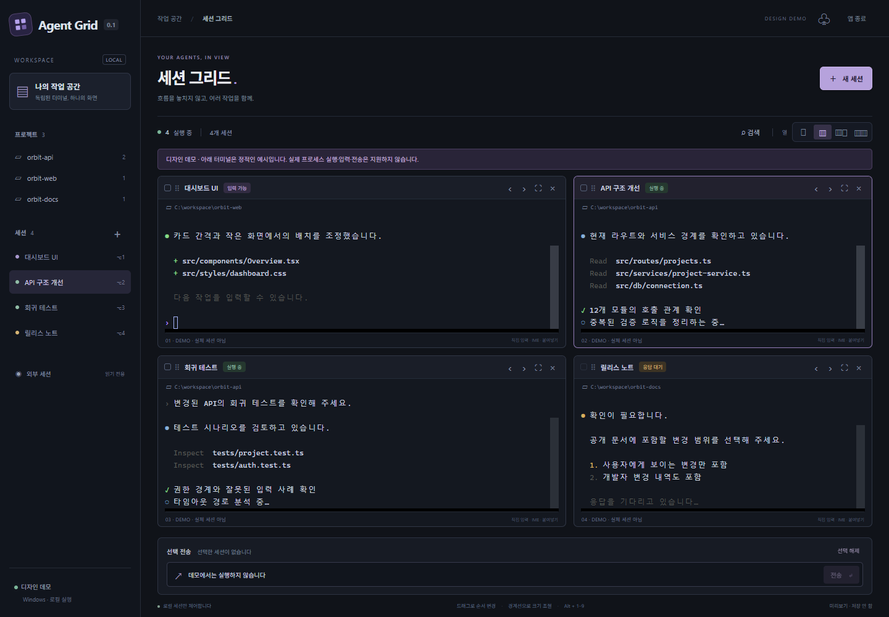

# OpenDIY Desktop

**English** | [한국어](README.ko.md)

A Windows desktop grid for running coding-agent CLI sessions side by side.

The Codex adapter supports [OpenDIY Codex](https://github.com/jaeseongs95/opendiy-codex),
the selected runtime for this project, and compatible official Codex CLI versions. Arrange terminals in a
resizable grid, group them by working directory, search terminal output and
send input to selected sessions. Waiting and unknown sessions are excluded
from group input. Each target reports its own delivery result.



*Original layout mock-up from the previous Agent Grid name, with static terminal examples; not runtime evidence.*

OpenDIY Desktop is an independent MIT implementation. It does not include code,
assets or branding from Claudes. That project's multi-terminal workflow was
a product reference; its source-available license does not permit unapproved
modification or redistribution. See the [reference license](https://github.com/paulallington/Claudes/blob/v1.9.82/LICENSE).

## Language

Select **한국어** or **English** from **언어 / Language** in the sidebar.
Changes apply immediately to the app interface and native tray/chooser labels,
and the desktop app saves the selection in its own SQLite settings for the next launch.
The default is Korean. Session titles, paths, conversations and terminal output
stay exactly as provided. CLI diagnostics and Windows system buttons can remain
in their original language; the app does not change the CLI or OS locale.

## Running

Download the portable ZIP or per-user installer from
[Releases](https://github.com/jaeseongs95/opendiy-desktop/releases). Windows x64 and
WebView2 are required. The application is unsigned.
Extract the whole portable ZIP and run `opendiy-desktop.exe`. Keep
`opendiy-desktop-helper.exe` beside it: Windows requires a console process for the
terminal side while the main application uses a normal desktop window.

Install and sign in to OpenDIY Codex or a compatible official Codex CLI first. Open **Executable settings**
and select its native `codex.exe`; the app saves that path for future starts
and history queries. The screen shows the saved path, resolved executable and
where it came from. Cancelling the chooser keeps the previous setting.
Changing it leaves running terminals alone.

Choose **Use automatic discovery** to clear the app's saved override. Resolution then uses
`AGENT_GRID_CODEX`, if set, followed by the native executable on `PATH`.
The saved app preference has priority over both. Missing or invalid executables
are reported explicitly instead of silently using a different program.
The CLI must support authenticated app-server WebSockets and `--remote`.
Older CLI versions are not silently downgraded to a different connection mode.

Choose **Import project** to select an existing local folder. Imported
projects remain in the sidebar after their terminals stop. The session browser
opens for that project; choose an existing conversation or start a new session
with its working directory already filled in.

Use the project tabs above the grid, or click a project in the sidebar, to
view that project's sessions. **All** shows every session. Switching tabs keeps
all terminals running and retains their output; group input and keyboard
session shortcuts apply only to the visible project. New sessions and the
session browser start with the selected project's directory.

**Load sessions** opens a two-pane popup. Search session titles and filter by
project on the left; inspect dates, the conversation ID and recent messages on
the right before resuming. Already open conversations focus their existing
terminal. Browsing uses read-only requests through a short-lived owned server,
so it does not require an existing desktop daemon. Recent messages are fetched
in bounded pages and are not stored in OpenDIY Desktop's database.

Use **New session** to enter a directory directly. Use the official TUI to choose
a model, sign in or answer permission prompts. Select
terminal cards before using group input. A reported delivery means bytes
reached that terminal; it does not mean a model accepted or completed a turn.

## Plugins and skills

Open **Plugins & skills** in the sidebar. The popup uses the executable selected
in **Executable settings**, and shows that executable and the selected project.
Search installed/available plugins and skills, install/remove or enable/disable
plugins, manage marketplace sources, and enable/disable skills. Import an existing
skill folder containing `SKILL.md` into the selected project or your user skill
folder. The review screen shows the exact target and scope before applying a change.
Existing destination folders are never overwritten; links and oversized imports
are rejected. Errors and unsupported CLI capabilities remain visible.

Plugin installation and marketplace changes use the CLI's own commands; skill
and setting changes use its app-server APIs. Existing CLI authentication and
configuration remain owned by that CLI. Changes are read back after applying.
Start a new session to use changed extensions; running terminals are not restarted.
This version does not claim shared mobile/daemon backend integration.

## Memory and history

History is loaded only on request: up to 50 sessions or conversation items per
page. The popup retains at most 250 session rows and 100 preview messages (128 KiB
of preview text), dropping older displayed pages as more are requested. Select a
session again to return to recent messages. Closing the popup releases its rows,
preview and selection; conversation bodies are not copied into the app database.
The extensions popup initially renders 50 rows, keeps at most 250 row elements,
and releases fetched data on close.
Terminal input also has bounded admission: at most 128 accepted requests and 256 KiB
including the current write, with the native 64 KiB per-request ceiling. Input pauses
under pressure and resumes after draining; oversized or unaccepted input is reported.
Resize keeps one current request and the latest unsent size. Disposing a terminal
releases queued input and geometry. Restored sessions initially load metadata only.
These bounds and lifecycle tests are not a claim of a completed long-duration leak test.

Existing saved settings and projects from Agent Grid are preserved. The longer-term
product direction is to learn from ChatGPT and Claude desktop workflows; the full
benchmark and broader feature migration are future work.

## Development

Requires Node.js 24, Rust stable, MSVC build tools and WebView2 on Windows.

```powershell
npm ci
npm test
npm run build
node scripts/notices.mjs
cargo test --locked --manifest-path src-tauri/Cargo.toml
npm run tauri -- dev
```

Package the console helper before the desktop bundle:

```powershell
cargo build --locked --manifest-path src-tauri/Cargo.toml --release --bin opendiy-desktop-helper
npm run tauri -- build --config src-tauri/tauri.bundle.conf.json --bundles nsis
```
If Unicode workspace paths cause native tool failures, build in a separate
checkout under `D:/codex/build/opendiy-desktop`.
Generate third-party notices before native compilation; they are bundled
with the installer and distributed alongside the portable executable.

## Codex

Install and sign in to OpenDIY Codex or a compatible official Codex CLI separately. OpenDIY Desktop uses
your existing login and honors `CODEX_HOME`. It never installs or updates the
CLI and never changes its global permission settings. Model selection stays
in Codex's own `/model` interface.

Each managed session has an owned authenticated loopback app-server and a
normal Codex terminal. External sessions are listed read-only through the
official daemon proxy; no daemon is started to populate that list. An
unreachable server or unknown runtime status is reported explicitly.

Closing the window hides it to the tray. Complete exit terminates owned
processes after confirmation. Restoring after a complete exit starts new
processes against the saved conversation ID, rather than reviving an old PID.
Authentication tokens are not stored in the application database.
Layout, session metadata, imported projects, the executable choice and language
are stored in the app's own SQLite database. Browser previews use WebView local storage.
Terminal transcripts and Codex authentication files are not copied there.

## Validation and releases

Windows CI runs frontend checks, Rust tests and packaging. Releases include
an unsigned Windows x64 portable ZIP, NSIS installer and SHA-256 sums.
Unsigned builds may trigger Windows reputation warnings.

Actual test results and remaining limits belong in release notes; a successful
build is not evidence of long-duration stability or complete CLI compatibility.

The packaged executable provides separate diagnostic modes:

```powershell
opendiy-desktop.exe --self-test --duration-seconds 60 --report D:/codex/build/pty-result.json
opendiy-desktop.exe --codex-smoke --sessions 2 --cwd D:/projects/already-trusted --report D:/codex/build/codex-result.json
```

The first exercises real native PTYs with local shell fixtures, including
2/8/16-session isolation, stale-generation rejection, bounded output,
cancellation and 100 create/stop cycles followed by eight sustained PTYs.
Use `--duration-seconds 14400` for four hours of sustained PTY activity.
The second starts actual Codex servers and remote TUIs without submitting
model prompts or answering trust/approval dialogs. `--cwd` must name an existing,
already trusted directory; the probe reads its startup context and does not
write project files. Keep the report directory outside that project. Omitting
`--cwd` creates fresh directories beside the report, which may stop at Codex's
normal trust screen. The probe
requires observed thread IDs and live statuses, and records terminal hashes
rather than transcripts. Neither mode proves physical IME or GUI behavior.
